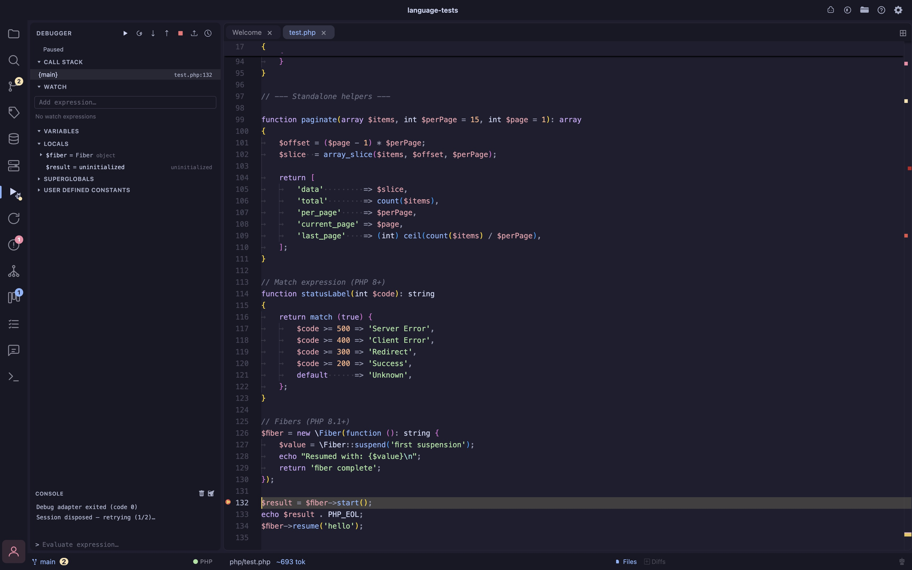
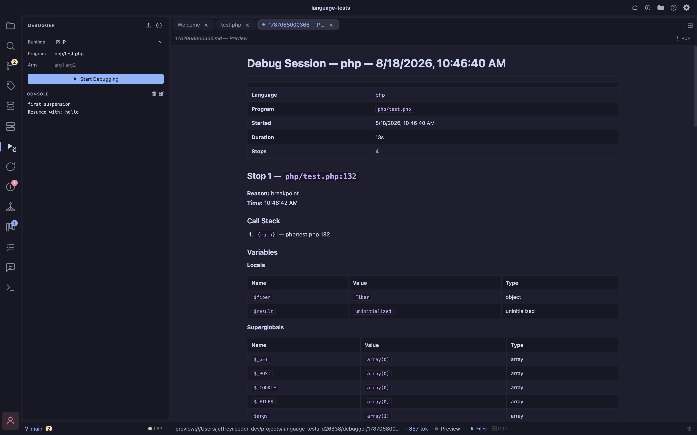

- **Multi-language** debug Node.js, Go, Rust, Zig, Swift, C/C++ (all via `lldb-dap` except Go/Node), Python, Ruby, and PHP (via xdebug) using the Debug Adapter Protocol (DAP); language auto-detected from the project, or manually selected in the launch form
- **Step controls** Continue, Step Over, Step In, Step Out, and Stop; controls are disabled while the program is running and re-enable on each pause
- **Breakpoints** click the gutter beside a line number to set one (a red dot); the **Breakpoints** list in the panel shows every one across all files, click an entry to jump to it, **×** to remove it, or **Remove all**. Breakpoints set by an AI agent trace or restored from Session history appear in the list too, even for files you haven't opened
- **Call stack** full stack trace on every pause; click any frame to load its local scope
- **Variables** all in-scope variables grouped by scope (Locals, Superglobals, etc.) with syntax-colored values and expandable objects/arrays
- **Watch expressions** add any expression to the Watch panel; evaluated at every pause using DAP `context: watch`; results update live and changed values are highlighted
- **Debug console** program output (stdout/stderr), adapter messages, and REPL in one scrollable panel; each category is color-coded; the REPL evaluates arbitrary expressions in the current frame
- **Session recording** every debug session is automatically recorded to `~/.coder/projects/{id}/debugger/{timestamp}.jsonl` in NDJSON format (one JSON record per line); sessions with zero stops are discarded automatically so timing noise from xdebug reconnects never pollutes history
- **Export to Markdown / HTML** export the full session, every stop, every variable, the complete call stack, and all console output, to a formatted `.md` or `.html` file; the exported file opens automatically as a new editor tab
- **Copy as AI-readable text** one-click copy of the entire session as a clean, compact text summary ready to paste into any AI chat; noise is stripped (empty values, `$_SERVER`, `$argv`, `$argc`, constants scopes) and variables that changed between stops are flagged with `*`
- **Session history** clock icon in the debugger header opens a modal listing every recorded session for the current project with language, entry-point filename, timestamp, and the breakpoints it was recorded with; each entry has **step through**, **rerun**, copy-as-text, and export (MD/HTML) actions (see [Replaying and rerunning sessions](#replaying-and-rerunning-sessions))
- **Retry on dispose** xdebug can close its socket before a new attach completes; the debugger retries automatically up to 3 times with escalating backoff (800 ms / 1600 ms) so a stale socket never blocks a fresh run
- **Toggle** `Cmd+Shift+D` opens and closes the Debugger panel

## Requirements

The debugger connects to debug adapters you have installed, none of them ship with Coder.
See [Language Intelligence → DAP, debuggers](/lsp#dap-debuggers) for the general picture, and each language's own page for its adapter's exact install steps and gotchas:
[PHP](/languages/php) · [TypeScript / JavaScript](/languages/typescript) · [Go](/languages/go) · [Rust](/languages/rust) · [Zig](/languages/zig) · [Python](/languages/python) · [Swift](/languages/swift) · [C / C++](/languages/cpp) · [Ruby](/languages/ruby)

Most compiled languages (Rust, Zig, Swift, C/C++) share the same `lldb-dap` setup (ships with the Xcode Command Line Tools via `xcode-select --install`, or `brew install llvm`) and require a binary you've already built (`cargo build` / `zig build` / `swift build` / your C compiler), the debugger doesn't invoke any of those build tools for you.

## Replaying and rerunning sessions

Every recorded session remembers how it was set up: the runtime, program, args, watch expressions, and **every breakpoint it ran with**. Open **Session history** (the clock icon) to use them.

Breakpoints are recorded as they change. Start a session with one breakpoint, add three more while it is paused, and the session's record shows **all four**: the history entry lists the final set, and each stop remembers which breakpoints were set at that moment. A finished session's record is then **frozen**. Breakpoints you add afterwards belong to the *next* session's record, which starts when you next run one and captures the set as it is then.

**Step through** (the double-arrow button) replays a recording without running anything. The Debugger panel switches to a player with *first / previous / next / last* buttons and a slider (or use the arrow keys, `Home`, `End`, `Esc`). Each stop opens the file at the line where it paused, with the yellow execution marker, and shows that stop's call stack, variables, console output, and the breakpoints that were set at that stop (ones added since the previous stop are marked **+**). Variables that are new or changed since the previous stop are highlighted, so you can watch a value evolve. Click a stack frame or a breakpoint chip to jump to it.

**Rerun** (the circular arrow) depends on what recorded the session:

- A session you ran from the panel restores its runtime, program, args, watches, and the breakpoints it **ended with**, then starts again. The breakpoints are *replaced* with the recorded ones so the run reproduces; stop any live session first.
- An AI agent trace (marked **agent**) runs the same trace again, then shows it in the Debug console and adds it to the history.

Sessions recorded before this feature existed can still be stepped through, but can't be rerun, because their setup wasn't saved.

Breakpoints you set in the gutter now stay visible when you switch tabs and come back.

## AI agent traces

An AI agent running in your terminal can trace PHP, JavaScript, or TypeScript code for you with a single command, no launch form and no adapter needed: it sets a breakpoint, runs your tests or script, and reads the values you care about each time the line is hit. See [Command Line & AI Agents → Debug traces](/cli#debug-traces).

You see exactly what the agent saw. Each trace is added to the **Debug console** (which opens next to your terminal) and recorded to **Session history** with an **agent** badge, so you can step through it, rerun it, copy it as text, or export it like any other session. Secret-looking values are masked before they are shown or saved.

Ask the agent to add `--dry` and it sets the bar up *without* running anything (see [Set up the debugger without running anything](/cli#set-up-the-debugger-without-running-anything)). A trace also sets up the debug bar for you, so you can pick it up interactively: its breakpoint appears in the gutter, its expressions are added to the Watch list, and the runtime (and the program and args, when the command is a plain script run) are filled in. Your existing breakpoints and watches are kept.

## Debugger Reports

