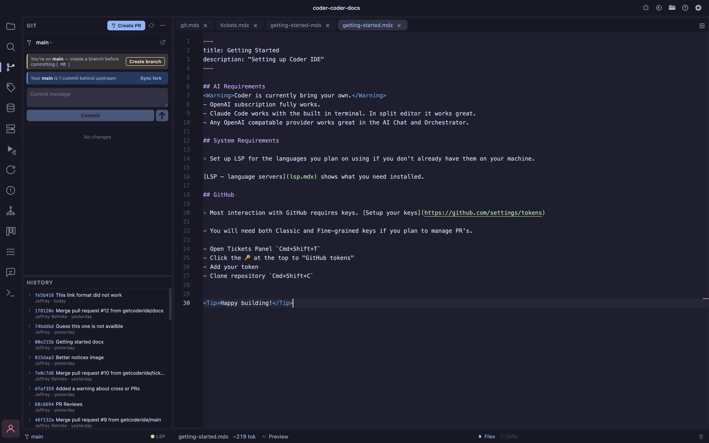
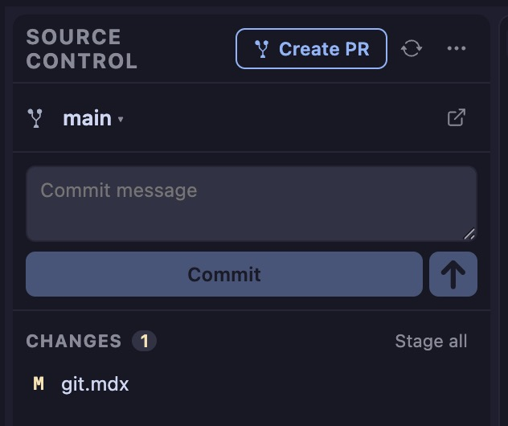
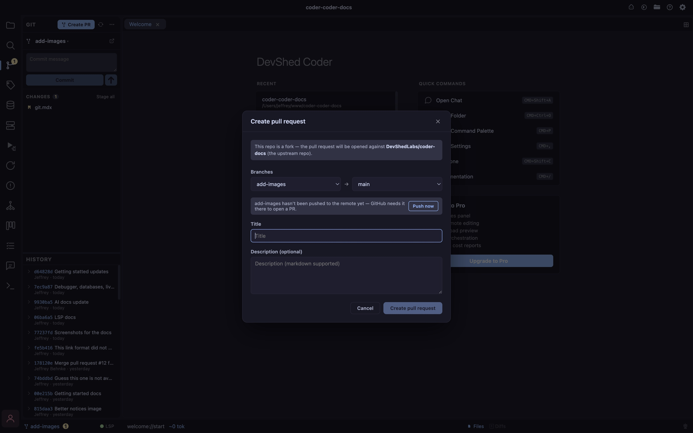

<Info>You will see 2 important notices in the above image.</Info>
1. The create branch notice. It appears whenever you're on the repo's default branch. The default is read from `origin/HEAD`; if that isn't set (common for repos made with `git init` + `git remote add`), Coder falls back to `main`, then `master`.
2. Sync notice, letting you know there are upstream changes.

## Workflows
- `Cmd+B` Create branch ( name + "from" branch dropdown, defaults to current ), creates + checks out in one step
- `Cmd+K` Stage all & commit
- `Cmd+U` Push ( now also auto-sets upstream for a brand-new branch )
- `Cmd+;` Create PR
- Delete branches (if you need)
- Manage tags from the **Tags** section of the Git panel (see [Tags](#tags))

<Warning>Creating cross org PR's requires a classic token with repo scope in GitHub</Warning>

## Details 

- **Status panel** staged, unstaged, and untracked files grouped and live-updated via FS watcher
- **Stage / unstage** per-file or all at once
- **Commit** message box with Cmd/Ctrl+Enter to commit; errors surfaced inline
- **Push / Pull / Fetch / Push tags** remote sync with in-flight indicator and inline error banner; **Push tags** sends all local tags to origin
- **Discard changes** per-file or discard-all with two-click confirm
- **Branch switcher** click the branch name to open a dropdown of local and remote branches; pick one to check out, with local branches checkmarked and grouped ahead of remote ones
- **Create branch** "+ New branch…" in the switcher creates and checks out in one step
- **Delete branch** trash icon per local branch (hidden on the current branch, no deleting the branch you're on) with a two-click confirm
- **Open on web** button next to the branch name opens the repo's page (GitHub, GitLab, or any host) in your default browser, resolved from your actual git remote, no more finding it manually
- **Branch + ahead/behind** always visible in the panel header and status bar
- **Dirty count badge** uncommitted file count shown right on the Git activity-bar icon, so you don't need the panel open to see there's something to commit
- Uses your system git, inherits your existing config, SSH keys, and credential helpers
- Create new PR's right from the interface
- **Git History** open the full commit graph in an editor tab, with filters, per-commit file lists, and right-click tag, branch, cherry-pick and merge actions — see [Git History](/git-history)
- **Git blame** see who last changed a line, inline on the cursor line or in a gutter column, with a hover card for the full commit — see [Git Blame](/git-blame)
- **Worktrees** create and manage git worktrees right from the Git panel — see [Workspaces & Worktrees](/workspaces)

__Auto Upstream detection__

## Tags

The **Tags** section in the Git panel shows the tag count and your latest tag. Click the tag icon to open the tag manager.

- **Create** enter a name and optionally an "At" target (a commit, branch, or tag; defaults to `HEAD`). Add a message to make it an **annotated** tag; leave it empty for a lightweight tag.
- **Browse and filter** every tag with its commit, date, tagger, and subject, searchable by name or subject
- **Check remote** contacts origin to mark each tag as `pushed` or `local only`. This is a network call, so it only runs when you ask (or right after an action that already talks to origin).
- **Push** a single tag (↑), or **Push all** (shows how many are unpushed once the remote has been checked)
- **Delete** a local tag (trash icon) or a tag on origin (⇡✕), each with a two-click confirm
- **Fetch tags** the refresh icon in the header pulls tags from origin
- **Copy name** copies the tag name to the clipboard

<Warning>Deleting a tag from origin removes it for everyone. Tags already pulled by others stay on their machines.</Warning>

## Shotcut Key Commands

| Shortcut | Action |
|---|---|
| Cmd+Shift+G | Toggle Git |
| Cmd+K | Git: stage all & commit |
| Cmd+U | Git: push |
| Cmd+B | Create branch |
| Cmd+; | Create PR |
| Cmd+Shift+C | Clone repository |
| Cmd+Shift+U | Create worktree |